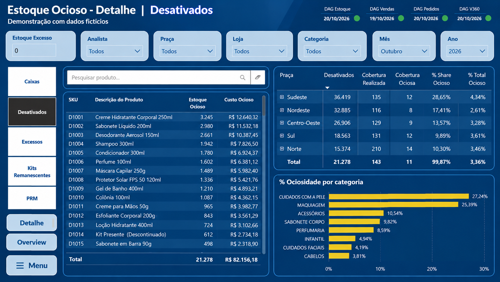
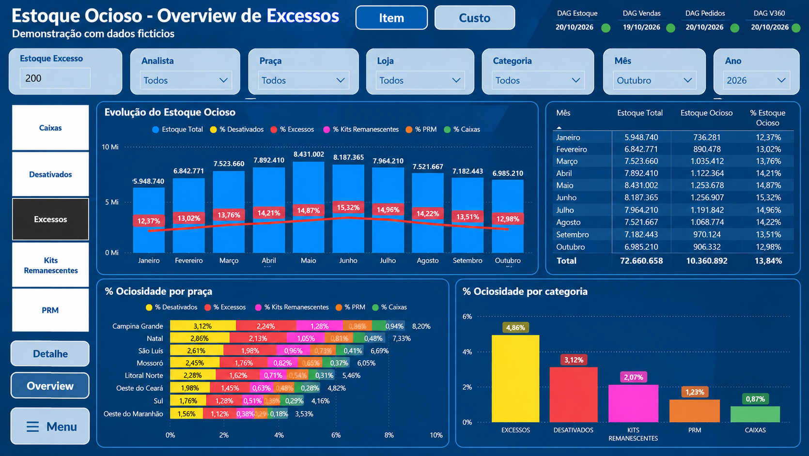
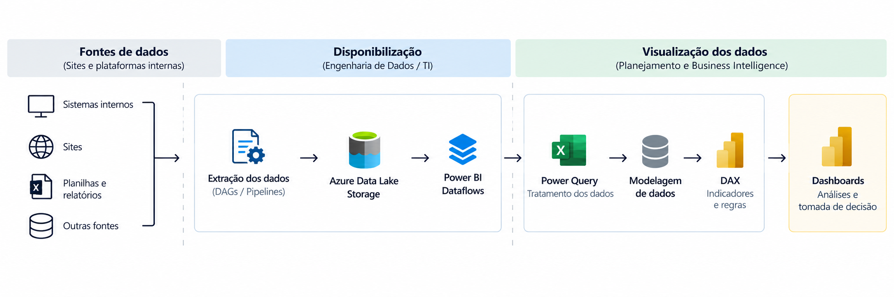

# Business Intelligence | Gestão de Estoque Ocioso

### Inteligência de Dados Aplicada ao Planejamento e Supply Chain

## Sobre o projeto

Como identificar oportunidades de venda e melhorar a distribuição dos produtos quando as informações sobre a qualidade dos estoques estão dispersas em diferentes sistemas e operações?

Foi a partir desse desafio que desenvolvi uma solução de Business Intelligence voltada à **identificação, ao monitoramento e à gestão de estoques ociosos** na cadeia de suprimentos.

O projeto centraliza informações operacionais e transforma dados em indicadores gerenciais, permitindo identificar produtos com baixa movimentação, estoques excedentes e materiais descontinuados.

Mais do que acompanhar números, a solução foi desenvolvida para **transformar a visibilidade dos estoques em oportunidades de ação**, conectando diferentes áreas da empresa e apoiando decisões que contribuam para melhorar a eficiência operacional.

## Impacto da solução no negócio

A implementação do BI tornou possível materializar a qualidade dos estoques em indicadores mensuráveis, proporcionando maior visibilidade sobre os produtos ociosos presentes em cada operação.

Com essas informações centralizadas, diferentes equipes passaram a contar com uma ferramenta de apoio às suas decisões:

### Planejamento | Melhor distribuição dos estoques

Identificação de oportunidades de transferência e redistribuição de produtos entre unidades, permitindo direcionar materiais com baixa movimentação para operações com maior potencial de venda.

A análise contribui para melhorar o aproveitamento dos estoques disponíveis e apoiar decisões mais assertivas de abastecimento.

### Eficiência | Ações direcionadas à redução da ociosidade

Visibilidade dos produtos parados, suas quantidades e representatividade financeira, permitindo identificar oportunidades e estruturar ações voltadas à redução dos estoques ociosos.

Com isso, a equipe consegue direcionar esforços aos materiais que demandam maior atenção.

### Comercial | Priorização de oportunidades de venda

Acesso a informações sobre produtos com baixa movimentação presentes nas operações comerciais, permitindo identificar itens que precisam de maior atenção nas estratégias de venda.

Essa visibilidade apoia a priorização de ações comerciais para acelerar o escoamento dos produtos e reduzir a permanência de materiais parados.

### Resultado para a operação

**O principal valor do projeto foi transformar o BI em uma ferramenta de gestão compartilhada**, conectando Planejamento, Eficiência e Comercial em torno de três objetivos:

- Melhorar a distribuição dos produtos entre as operações.
- Reduzir a concentração de estoques ociosos.
- Aumentar a agilidade na identificação e execução de oportunidades.

A solução ampliou a autonomia das equipes e facilitou o acesso a informações antes dispersas, contribuindo para decisões mais rápidas e orientadas por dados.

## Indicadores e análises desenvolvidos

O BI foi estruturado para oferecer duas perspectivas complementares: uma visão gerencial, voltada ao acompanhamento dos resultados, e uma visão detalhada, direcionada à identificação dos produtos e das oportunidades de atuação.

Entre as principais análises estão:

- **Excessos de estoque:** identificação de produtos com baixa movimentação e cobertura elevada.
- **Produtos desativados:** acompanhamento de materiais descontinuados que permanecem em estoque.
- **Kits remanescentes:** identificação de estoques provenientes de campanhas comerciais encerradas.
- **Materiais de apoio:** acompanhamento de categorias específicas, como embalagens e materiais promocionais.
- **Cobertura de estoque:** avaliação da disponibilidade de produtos em relação ao comportamento das vendas.
- **Percentual de ociosidade:** representatividade dos materiais ociosos em relação ao estoque total.
- **Custo do estoque ocioso:** mensuração financeira dos produtos classificados como ociosos.
- **Evolução histórica:** acompanhamento da qualidade dos estoques ao longo dos períodos.

As análises podem ser segmentadas por operação, unidade, região, categoria e período, permitindo identificar oportunidades tanto em nível estratégico quanto operacional.

## Demonstração visual

As imagens abaixo apresentam versões demonstrativas dos dashboards desenvolvidos.

Para preservar a confidencialidade das informações corporativas, foram utilizadas ferramentas de inteligência artificial para substituir dados e elementos identificáveis por informações fictícias, mantendo a proposta visual e analítica da solução.

### 1. Análise detalhada | Produtos desativados

Painel analítico desenvolvido para identificar produtos descontinuados e acompanhar sua distribuição entre as operações.

A visualização permite analisar quantidades, custos, cobertura e participação por categoria, facilitando a identificação dos materiais que exigem atenção e o direcionamento de ações específicas.

**Aplicação no negócio:** apoiar a identificação de produtos que precisam de estratégias de escoamento, redistribuição ou outras ações para reduzir a permanência de estoques sem movimentação.

### 2. Visão gerencial | Excessos de estoque

Painel gerencial desenvolvido para acompanhar a evolução mensal dos estoques, os percentuais de ociosidade e a representatividade das diferentes categorias e operações.

A visualização reúne indicadores executivos e análises comparativas, facilitando a identificação de tendências e a definição de prioridades.

**Aplicação no negócio:** permitir que gestores acompanhem a qualidade dos estoques, identifiquem operações com maiores oportunidades de melhoria e direcionem os esforços das equipes.

## Desafios enfrentados no desenvolvimento

Um dos principais desafios do projeto não estava apenas na construção dos dashboards, mas na disponibilidade das informações necessárias para desenvolver os indicadores.

Parte dos dados estava distribuída em sites e plataformas internas da empresa, exigindo extrações manuais demoradas e pouco eficientes para análises recorrentes.

Além disso, algumas informações ainda não estavam disponíveis por meio de fontes automatizadas.

### Mapeamento das extrações e viabilização de novas fontes

Para superar essa limitação, realizei o mapeamento dos processos de extração manual, identificando onde as informações estavam disponíveis, como eram obtidas e quais dados seriam necessários para atender às demandas analíticas.

Esse levantamento serviu como referência para o alinhamento com as equipes de Engenharia de Dados e TI, responsáveis pelo desenvolvimento dos pipelines e DAGs necessários à disponibilização automatizada das informações.

Minha atuação envolveu o levantamento das necessidades, o mapeamento das fontes, a documentação dos procedimentos e o acompanhamento das solicitações junto às equipes técnicas.

**O desenvolvimento e a manutenção dos pipelines e DAGs ficaram sob responsabilidade da Engenharia de Dados e TI.**

### Tratamento, modelagem e desempenho

Com as fontes disponibilizadas, o desenvolvimento passou a envolver a integração de informações com diferentes granularidades, a construção de regras analíticas e a otimização do desempenho dos relatórios.

Entre as atividades realizadas estiveram a transformação dos dados no Power Query, a estruturação do modelo de dados, o desenvolvimento de medidas DAX e a revisão de consultas para melhorar a eficiência do processamento.

Essas etapas foram fundamentais para disponibilizar uma solução que atendesse tanto às análises detalhadas quanto ao acompanhamento gerencial.

## Arquitetura e fluxo de dados

O diagrama abaixo apresenta, de forma conceitual, o fluxo das informações desde os sistemas de origem até sua disponibilização nos dashboards.

O processo conecta as fontes operacionais, a disponibilização dos dados pelas equipes técnicas e o desenvolvimento das análises no ambiente de Business Intelligence.

## Tecnologias e ferramentas

| Tecnologia | Aplicação |
|---|---|
| Power BI | Desenvolvimento dos dashboards analíticos e gerenciais |
| Power Query | Integração, tratamento e transformação dos dados |
| DAX | Construção de indicadores, cálculos e regras analíticas |
| Power BI Dataflows | Consumo de dados corporativos disponibilizados para análise |
| Azure Data Lake Storage | Acesso a fontes de dados armazenadas no ambiente corporativo |
| Power BI Service | Publicação e disponibilização dos relatórios |

## Minha atuação no projeto

Atuei como **Analista de Planejamento com foco em Dados e Business Intelligence**, sendo responsável por conectar as necessidades das áreas de negócio ao desenvolvimento da solução analítica.

Minhas principais responsabilidades envolveram:

- Levantamento de necessidades e definição de indicadores.
- Mapeamento de processos de extração e identificação de fontes de dados.
- Interface com Engenharia de Dados e TI para viabilização de novas fontes.
- Integração, tratamento e modelagem dos dados.
- Desenvolvimento de medidas DAX e implementação de regras de negócio.
- Construção de dashboards gerenciais e operacionais.
- Otimização de consultas e desempenho dos relatórios.
- Disponibilização de informações para apoiar diferentes áreas da empresa.

O projeto representa a aplicação de conhecimentos em Planejamento, Supply Chain e Business Intelligence para transformar necessidades operacionais em soluções analíticas com valor para o negócio.

## Confidencialidade

Este repositório apresenta um estudo de caso profissional com finalidade demonstrativa.

As imagens utilizam informações fictícias e não representam resultados reais da empresa. Não são disponibilizados dados corporativos, credenciais, códigos internos, fontes proprietárias ou regras de negócio confidenciais.
